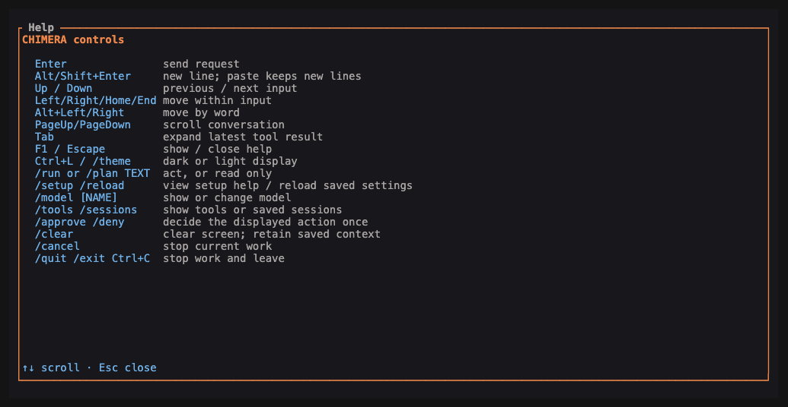

# CHIMERA user commands sheet

Reviewed 14 October 2026.

[README](../README.md) · [Quick start](QUICKSTART.md) · [User manual](USER_MANUAL.md)

For CHIMERA 0.1.0. Run terminal commands from your project folder. `chimera` means the installed program or its full path. Replace uppercase names such as `SESSION_ID` with real values shown by the app. Quoted text is your request.

## The everyday set

| Command | What it does |
| --- | --- |
| `chimera --version` | Show the app version. |
| `chimera --help` | List command groups. Add `--help` to any group or command for its arguments. |
| `chimera init` | Create missing settings without replacing an existing file. |
| `chimera doctor` | Check local settings and records; does not contact the model. |
| `chimera status` | Show this project's conversation count and policy. |
| `chimera tui` | Open chat. |
| `chimera tui "request"` | Open chat with a starting request. |
| `chimera run "request"` | Run a request in the ordinary terminal. |
| `chimera run -i "request"` | Run a request in chat; `-i` means `--interactive`. |
| `chimera plan "request"` | Read and plan; reject file changes and shell commands. |

## Inside chat

Type these in CHIMERA, not at your shell prompt.

| Command | What it does |
| --- | --- |
| `/help` or `/?` | Open help. |
| `/setup` | Show setup guidance and your settings-file path. |
| `/reload` | Reload saved settings when no request is running. |
| `/model` | Show the selected model. |
| `/model NAME` | Change the model for this open chat; does not save it to the settings file. |
| `/tools` | List built-in tool descriptions. |
| `/sessions` | List this project's saved session identifiers. |
| `/plan TEXT` | Send a request in read-only mode. |
| `/run TEXT` | Send a normal request, subject to saved permissions. |
| `/approve` or `/deny` | Decide the currently displayed action once. |
| `/cancel` | Stop the current request and stay in chat. |
| `/clear` | Clear displayed messages; keep saved conversation context. |
| `/theme` | Switch between light and dark. |
| `/quit` or `/exit` | Stop work and leave the screen. |

Plain text sends a normal request. A saved read-only policy still applies to `/run`.

| Key | Action |
| --- | --- |
| Enter | Send input. |
| Shift+Enter or Alt+Enter | Add a new line, if your terminal sends that key combination. |
| Up / Down | Browse earlier input; scroll when help is open. |
| Left / Right / Home / End | Move the input cursor. |
| Alt+Left / Alt+Right | Move by word. |
| PageUp / PageDown | Scroll the conversation. |
| Tab | Expand the latest tool result. |
| F1 / Escape | Open / close help. |
| Ctrl+L | Switch theme. |
| Ctrl+C | Stop work and leave chat; cancel active work in ordinary terminal mode. |



## Saved work and recovery

```sh
chimera session list
chimera session resume SESSION_ID
chimera session fork SESSION_ID
chimera session recover SESSION_ID
chimera session export SESSION_ID
chimera replay SESSION_ID
chimera checkpoint create --session SESSION_ID --file src/example.rs
chimera checkpoint list
chimera rollback CHECKPOINT_ID
```

Repeat `--file` for each file to capture. Without `--session`, checkpoint creation selects the newest session. `recover` restores a previous session record and preserves the damaged one. `rollback` asks before restoring captured files. `replay` shows private conversation text; `export` omits conversation bodies, tool arguments, and file paths.

## Permissions and tools

```sh
chimera policy show
chimera policy edit
chimera policy set read-only
chimera policy set supervised
chimera autonomy set none
chimera autonomy set low
chimera autonomy set medium
chimera leash all
chimera approve list
chimera approve next
chimera approve action ACTION_ID
chimera deny ACTION_ID
chimera tool list
chimera tool inspect TOOL_NAME
chimera tool healthcheck TOOL_NAME
chimera tool test git_status
chimera tool disable bash
chimera tool enable bash
```

`policy edit` prints the policy-file path and guidance; it does not open an editor. `none` stops agent tools, `low` reviews every tool action, and `medium` reviews changes and commands. `leash all` selects review of every action. Health checks show registration, not a successful real call. Generic tool tests support `glob`, `grep`, and `git_status` only. `approve plan` is deliberately unavailable; approve exact actions instead.

## Specialists and saved command environments

```sh
chimera swarm "objective"
chimera pack ship-hotfix --objective "objective"
chimera pack TEAM_NAME --definition team.json --objective "objective"
chimera creature spawn raven --count 1 --objective "objective"
chimera creature list
chimera creature inspect CREATURE_ID
chimera creature stop CREATURE_ID
chimera creature leash CREATURE_ID
chimera creature promote CREATURE_ID
chimera leash CREATURE_ID
chimera world spawn local_shell
chimera world list
chimera world inspect WORLD_ID
chimera world exec WORLD_ID "command" --timeout 120
chimera run "objective" --world WORLD_ID
chimera world pause WORLD_ID
chimera world resume WORLD_ID
chimera world close WORLD_ID
```

Use saved identifiers for creature controls. `promote` can restore supervised operation, not unrestricted permission. Supported world types are `local_shell`, `worktree_read_only`, and `worktree_read_write` (`worktree` is an alias for the last). A worktree is a separate working copy of a Git project. Virtual-machine and container world types are unavailable. `--world` works in ordinary terminal mode, not chat.

## Memory, repeatable work, and checks

```sh
chimera memory remember KEY "fact to keep"
chimera memory list
chimera memory show MEMORY_ID
chimera memory forget MEMORY_ID
chimera memory compact
chimera skill capture NAME SESSION_ID --description "what it does"
chimera skill list
chimera skill inspect NAME
chimera skill run NAME
chimera eval define NAME --file src/example.rs --command "your check command"
chimera eval list
chimera eval run NAME
chimera eval compare CHECKPOINT_A CHECKPOINT_B
chimera trace live
chimera trace show SESSION_ID
chimera trace export SESSION_ID
```

`forget` archives a memory; `compact` combines exact duplicates. A skill saves a completed objective to run again. It does not freeze tool arguments or grant permission. Evaluation commands run real checks. `trace live` follows saved event types until Ctrl+C; `trace show` displays saved conversation text.

## Background work

```sh
chimera schedule hourly "Review changed source files."
chimera schedule daily "Review changed source files."
chimera schedule every:900 "Review changed source files."
chimera watch "Review changed source files." --pattern "src/**"
chimera up
chimera daemon status
chimera jobs list
chimera jobs inspect JOB_ID
chimera jobs pause JOB_ID
chimera jobs resume JOB_ID
chimera jobs cancel JOB_ID
chimera down
```

`daemon start` and `daemon stop` are alternatives to `up` and `down`. `daemon serve` runs in the current terminal. Schedule frequencies also accept `once:DATE_WITH_TIME_ZONE` and `cron:FIVE_NUMERIC_UTC_FIELDS`. The manual explains approvals and interrupted jobs.

## Optional browser, device, and external tools

```sh
chimera browser open https://example.com --allow-origin https://example.com --actions actions.json --output-dir evidence
chimera phone boot PROFILE --app app.apk --package APP_PACKAGE --network
chimera mcp --config servers.json tools SERVER
chimera mcp --config servers.json call SERVER TOOL --args '{"key":"value"}'
chimera mcp --config servers.json resources SERVER
chimera mcp --config servers.json read SERVER RESOURCE_URI
chimera mcp --config servers.json healthcheck SERVER
chimera run "objective" --mcp-config servers.json
```

`mcp` connects external tool programs. Starting them and calling their tools requires approval. `--mcp-config` cannot be combined with `--world` or interactive chat. Browser and Android commands need their dependencies installed. See the [manual](USER_MANUAL.md#optional-connections) before using them.

## Notifications

```sh
chimera notify destination local --terminal
chimera notify destination NAME --url HTTPS_URL
chimera notify destinations
chimera notify disable NAME
chimera notify send NAME "Subject" "Message body"
chimera notify approval ACTION_ID --destination NAME
chimera notify list
chimera notify inspect MESSAGE_ID
chimera notify inbox
chimera notify acknowledge MESSAGE_ID
```

Sending requires review. A message receipt never approves an action. The recipient must approve or deny the exact action from an authenticated terminal for this project.

## Common flags

`--format human` is the default. `--format json` gives structured output for scripts; interactive chat requires human output. `--profile read-only` restricts that invocation. `--profile supervised` still respects saved project restrictions. `-v` or `--verbose` enables extra diagnostics. `-h` and `-V` mean help and version.
