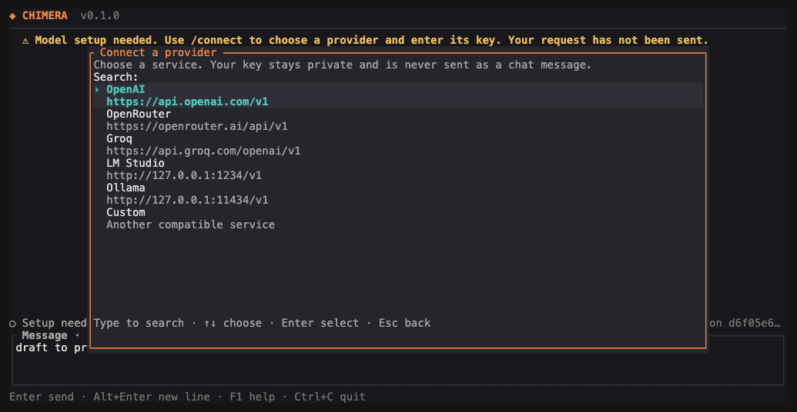

# CHIMERA quick start

Reviewed 14 October 2026.

[README](../README.md) · [Commands](COMMANDS.md) · [Full manual](USER_MANUAL.md)

Get the app open, connect a model, and do one small piece of work. This guide covers CHIMERA 0.1.0 on macOS.

## 1. Get the program

If CHIMERA is already installed:

```sh
chimera --version
chimera --help
```

To build from this repository, use Rust 1.98 or later and Cargo, Rust's build tool:

```sh
cargo build --locked --release -p chimera-cli
./target/release/chimera --version
```

In the rest of this guide, `chimera` means your installed program or the **full path** to `target/release/chimera`. Keep that path when you move to another project folder. Building does not install a model or start a model server.

## 2. Open your project

```sh
cd /path/to/your/project
chimera init
chimera tui
```

Replace `/path/to/your/project` with the folder you want CHIMERA to work in. `init` creates the settings file if needed and preserves existing settings. The screen can open even when model setup is incomplete.

Press F2 or type `/connect` and press Enter. `/setup` opens the same chooser.



## 3. Connect a model

1. Choose OpenAI, OpenRouter, Groq, LM Studio, Ollama, or Custom. Type to narrow the list; use the arrow keys and Enter to select.
2. Keep the supplied address or enter your own. Local services must already be running with a model loaded.
3. Paste the access key into the masked key field. Local services can usually leave it blank. Press Enter to check the connection.
4. Choose from the models returned by the service. CHIMERA saves the connection and selected model, then returns to chat.

Tab moves between fields. Ctrl+U clears a field. Escape cancels without changing your saved settings. Pressing F2 while composing a request preserves the draft.

The check fetches model names; it does not send a chat request. A rejected key, unavailable service, or empty model list appears in the form so you can correct it and retry. Keys never enter the conversation or input history. Saved settings and their previous copies are readable only by your account.

Saved connections appear at the top of `/connect`. Advanced file and environment settings remain available in the [manual](USER_MANUAL.md#model-settings). Explicit environment settings still apply on a later launch or `/reload`.

## 4. Check the connection

Send a short request in the same chat:

```text
Reply with a short greeting. Do not use tools.
```

The provider chooser checks the model list. This greeting checks whether the selected model can answer. If needed, `chimera doctor` checks local settings and saved records. See [troubleshooting](USER_MANUAL.md#when-something-goes-wrong) for connection errors.

## 5. Do one small job

In the chat screen, enter:

```text
/plan Read this project and suggest one small improvement. Do not change files.
```

When you are happy with the suggestion:

```text
/run Make that small improvement and run the relevant check.
```

Read each proposed action. `/approve` allows that exact action once; `/deny` refuses it. In ordinary terminal mode, answer the action prompt with `yes` or `no`. Read the changed files and check output before treating the job as finished.

## 6. Leave and come back

Use `/quit` to leave the screen. To find and reopen saved work:

```sh
chimera session list
chimera session resume SESSION_ID
```

Replace `SESSION_ID` with an identifier from the list. Run both commands in the same project folder.

Keep these close: **F1** for help, **Escape** to close help, **`/cancel`** to stop work while staying in chat, and **`/quit`** to stop and leave. The [commands sheet](COMMANDS.md) has the rest.
