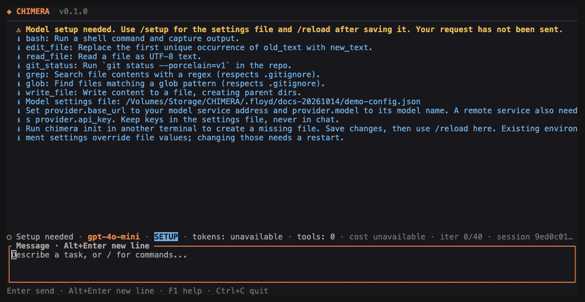

# CHIMERA quick start

Reviewed 14 October 2026.

[README](../README.md) · [Commands](COMMANDS.md) · [Full manual](USER_MANUAL.md)

Get the app open, connect a model, and do one small piece of work. This guide covers CHIMERA 0.1.0 on macOS.

## 1. Get the program

If CHIMERA is already installed:

```sh
chimera --version
chimera --help
```

To build from this repository, use Rust 1.98 or later and Cargo, Rust's build tool:

```sh
cargo build --locked --release -p chimera-cli
./target/release/chimera --version
```

In the rest of this guide, `chimera` means your installed program or the **full path** to `target/release/chimera`. Keep that path when you move to another project folder. Building does not install a model or start a model server.

## 2. Open your project

```sh
cd /path/to/your/project
chimera init
chimera tui
```

Replace `/path/to/your/project` with the folder you want CHIMERA to work in. `init` creates the settings file if needed and preserves existing settings. The screen can open even when model setup is incomplete.

Type `/setup` and press Enter. It shows the exact settings-file location. The usual location is `~/.chimera/config.json`; `CHIMERA_CONFIG` can select another file.



*This demonstration uses a separate settings file. Your `/setup` output gives your own path.*

## 3. Connect a model

Edit the settings file in your text editor. Keep any existing settings you need. Choose one of these paths.

### A model running on your computer

Start your model service and load a model in that service first. Copy its service address and exact model name into the file. For example:

```json
{
  "provider": {
    "name": "local",
    "base_url": "http://127.0.0.1:1234/v1",
    "model": "YOUR_LOADED_MODEL",
    "api_key": ""
  }
}
```

Replace the example address if your service uses a different port. Replace `YOUR_LOADED_MODEL` with its actual model name. The address must accept the OpenAI-compatible chat format: the request format CHIMERA uses to talk to a model. A provider name such as `local` is only a label; it does not set the address for you.

### A hosted model service

Use the service's compatible base address, exact model name, and access key:

```json
{
  "provider": {
    "name": "my-provider",
    "base_url": "https://YOUR_PROVIDER_HOST/v1",
    "model": "YOUR_MODEL_NAME",
    "api_key": "YOUR_PRIVATE_KEY"
  }
}
```

These are placeholders, not working credentials. Keep the key in your private settings or `CHIMERA_API_KEY`, never in chat or the repository. Hosted requests use your service account and may cost money.

Save the file. In CHIMERA, type `/reload`. After a successful reload, send your request. If you changed environment settings instead of the file, restart CHIMERA; `/reload` cannot change the environment of an already running app.

## 4. Check the connection

In another terminal, from the same project:

```sh
chimera doctor
chimera run "Reply with a short greeting. Do not use tools."
```

`doctor` checks local settings and saved records. The greeting checks whether the configured model actually answers. If it cannot connect, confirm that the service is running, the address is right, and the named model is loaded. The [manual's troubleshooting section](USER_MANUAL.md#when-something-goes-wrong) covers other common errors.

## 5. Do one small job

In the chat screen, enter:

```text
/plan Read this project and suggest one small improvement. Do not change files.
```

When you are happy with the suggestion:

```text
/run Make that small improvement and run the relevant check.
```

Read each proposed action. `/approve` allows that exact action once; `/deny` refuses it. In ordinary terminal mode, answer the action prompt with `yes` or `no`. Read the changed files and check output before treating the job as finished.

## 6. Leave and come back

Use `/quit` to leave the screen. To find and reopen saved work:

```sh
chimera session list
chimera session resume SESSION_ID
```

Replace `SESSION_ID` with an identifier from the list. Run both commands in the same project folder.

Keep these close: **F1** for help, **Escape** to close help, **`/cancel`** to stop work while staying in chat, and **`/quit`** to stop and leave. The [commands sheet](COMMANDS.md) has the rest.
