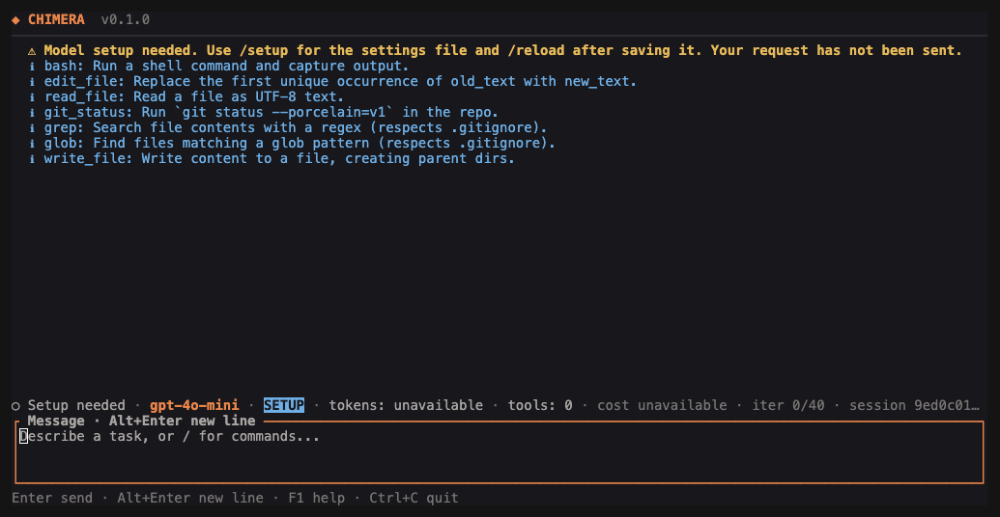

# CHIMERA user manual

Reviewed 14 October 2026.

[README](../README.md) · [Quick start](QUICKSTART.md) · [Commands sheet](COMMANDS.md)

CHIMERA brings a language model into your project terminal. You supply the model connection and the request. CHIMERA supplies the tools, saved conversations, and action review. This manual describes version 0.1.0 and its macOS execution path.

## Contents

- [Install and open](#install-and-open)
- [Model settings](#model-settings)
- [Working in chat](#working-in-chat)
- [Approvals and permissions](#approvals-and-permissions)
- [Save, resume, and recover](#save-resume-and-recover)
- [Tools, teams, and command environments](#tools-teams-and-command-environments)
- [Memory, workflows, and checks](#memory-workflows-and-checks)
- [Background work](#background-work)
- [Optional connections](#optional-connections)
- [When something goes wrong](#when-something-goes-wrong)
- [Private data and maintenance](#private-data-and-maintenance)

## Install and open

Use an existing installation with `chimera --version`. To build from source, install Rust and Cargo first. The current build uses Rust 1.98. From the repository:

```sh
cargo build --locked --release -p chimera-cli
./target/release/chimera --version
./target/release/chimera --help
```

The executable is `target/release/chimera`. Use its full path if you have not installed it. In this manual, `chimera` stands for that path or your installed command.

Run it from the project you want to work on:

```sh
cd /path/to/your/project
chimera init
chimera tui
```

Replace the example project path. Settings normally live in `~/.chimera/config.json`. `init` creates a missing settings file and preserves an existing one. It does not install or start a model service.

An interactive screen can remain open while you fix missing settings. `/connect` (also `/setup` or F2) opens guided provider setup; `/reload` reads saved settings again. Ordinary `run` and `plan` commands require valid model settings before starting work.

### Installing a local release package

If you have a CHIMERA package containing `release.json`, `SHA256SUMS`, and `install.py`, use its bundled installer. From the unpacked package folder:

```sh
python3 install.py install --package . --prefix "$HOME/.local"
python3 install.py status --prefix "$HOME/.local"
```

Put `$HOME/.local/bin` on your shell's command search path if needed. Use `update` in place of `install` for an existing managed installation. The installer verifies the package and preserves replaced files. See the package's `PACKAGE.md` for its machine type and details. Do not point this command at the source repository as though it were a packaged release.

## Model settings

CHIMERA uses a service that accepts OpenAI-compatible chat requests. That means the service understands the request format CHIMERA sends; the service can run locally or be hosted elsewhere. The provider chooser supplies addresses for common services, asks for a masked key, checks the service, and lists its models. Choosing a model saves the connection and returns to chat. Saved providers remain available in the chooser. Escape cancels; F2 preserves an unsent draft. The check reads the model list without sending a chat request.

For advanced manual settings, a provider name in the file remains a display label. The file format below is still supported.

This example is for a service on your own computer:

```json
{
  "provider": {
    "name": "local",
    "base_url": "http://127.0.0.1:1234/v1",
    "model": "YOUR_LOADED_MODEL",
    "api_key": "",
    "temperature": 0.0,
    "max_tokens": 8192,
    "request_timeout_secs": 120,
    "idle_timeout_secs": 30,
    "max_response_bytes": 8388608
  },
  "agent": {
    "max_iterations": 40
  }
}
```

Use the service's actual address and model name. CHIMERA adds `/chat/completions` to the base address. The example does not start a server. Hosted services also need an access key; use private settings or `CHIMERA_API_KEY`. Never enter keys into chat.

| Setting | Meaning |
| --- | --- |
| `name` | Provider label shown in the app. |
| `base_url` | Service base address, usually ending in `/v1`. |
| `model` | Exact model name recognized by that service. |
| `api_key` | Access key, when required. |
| `temperature` | Sampling setting passed to the model. |
| `max_tokens` | Requested output limit; tokens are pieces of text counted by the model. |
| `request_timeout_secs` | Total time allowed for one model request. |
| `idle_timeout_secs` | Allowed wait between response pieces. |
| `max_response_bytes` | Maximum response size CHIMERA accepts. |
| `agent.max_iterations` | Maximum model/tool steps for a request. |

Settings are JSON: use double quotes and no trailing commas. Unknown fields and invalid explicit settings produce errors rather than silently switching services.

### Which settings win?

CHIMERA reads its defaults, overlays the selected file, then overlays `CHIMERA_*` environment values. `OPENAI_API_KEY` is a fallback when neither an explicit CHIMERA key nor a file key is set. This fallback also applies when using local providers.

| Environment variable | Overrides |
| --- | --- |
| `CHIMERA_CONFIG` | Selected settings-file path. |
| `CHIMERA_PROVIDER` | Provider name. |
| `CHIMERA_BASE_URL` | Service address. |
| `CHIMERA_MODEL` | Model name. |
| `CHIMERA_API_KEY` | Access key. |
| `CHIMERA_TEMPERATURE` | Temperature. |
| `CHIMERA_MAX_TOKENS` | Output limit. |
| `CHIMERA_REQUEST_TIMEOUT_SECS` | Total request timeout. |
| `CHIMERA_IDLE_TIMEOUT_SECS` | Response idle timeout. |
| `CHIMERA_MAX_RESPONSE_BYTES` | Response size limit. |
| `CHIMERA_MAX_ITERATIONS` | Work step limit. |

To choose a separate file for one launch:

```sh
CHIMERA_CONFIG=/absolute/path/to/config.json chimera tui
```

After editing the file, finish or cancel active work and use `/reload`. Changes to environment values require restarting the app. `/model NAME` changes the current chat's choice; edit the settings file for a lasting default. Reloading returns to the configured settings.

### Check a connection

```sh
chimera doctor
chimera run "Reply with a short greeting. Do not use tools."
```

The first checks settings, saved sessions, and tool registration. The second sends a real request. A greeting alone does not prove that your model supports tool calls. Follow it with a small read-only project request before a larger job. Hosted requests use your account and may cost money.

## Working in chat

Launch `chimera tui`, `chimera tui "request"`, or `chimera run --interactive "request"`. Type normally and press Enter to send. Follow-up messages keep the saved conversation context.



Start with a small request: “Read the project and explain how its tests run.” Use `/plan TEXT` when you want reading and advice without file changes or shell commands. Use `/run TEXT` when you want action under the current permissions.

A useful work cycle is: ask for an explanation, agree on one change, review the exact proposed action, then inspect the files and check results. A model saying “done” is not independent proof of its claim.

F1 opens help; Escape closes it. Shift+Enter or Alt+Enter adds a new line when supported by your terminal. PageUp and PageDown scroll. Tab expands the latest tool result. Up and Down recall earlier input. `/theme` or Ctrl+L switches the display.

Use `/cancel` to stop a request without leaving. `/quit`, `/exit`, or Ctrl+C stops work and exits chat. `/clear` clears the displayed messages, not saved history or context. To start a separate conversation, leave and launch a new chat.

Usage totals appear only when the service supplies them. The app does not estimate cost. An empty or unfinished answer, failed tool, or exhausted work limit must be treated as unfinished work.

## Approvals and permissions

Ordinary execution reviews each file change and shell command. Read the tool name, file, command, and arguments before deciding. In chat, use `/approve` or `/deny`. In the ordinary terminal, type `yes` or `no` at the review prompt. Approval applies once to those exact arguments and expires after five minutes.

To review saved pending actions from another terminal in the same project:

```sh
chimera approve list
chimera approve action ACTION_ID
chimera deny ACTION_ID
```

Replace `ACTION_ID` with a pending identifier. `approve next` opens review of the oldest pending action. Blanket `approve plan` is unavailable.

`policy set read-only` saves a project restriction on changes and commands. `policy set supervised` returns to normal review. `--profile read-only` restricts one invocation. Selecting supervised mode does not cancel an existing saved read-only restriction.

`autonomy set none` stops agent tools. `low` asks before every tool; `medium` asks before changes and commands. Higher automatic permissions are unavailable. `leash all` selects review of every action. A disabled tool remains disabled until explicitly enabled.

Files read before an edit are checked for intervening changes. Original file contents are preserved for recovery. Tools have project and private-data boundaries; an approval does not grant unrestricted access to the machine or network.

Scripts can use `--format json`. Without interactive review, an action is normally denied. `CHIMERA_WAIT_APPROVAL=1` lets an ordinary run wait for an exact decision from another terminal in the same project. A program reading structured output must still inspect the final result and process exit status.

## Save, resume, and recover

Run these from the original project folder:

```sh
chimera session list
chimera session resume SESSION_ID
chimera session fork SESSION_ID
chimera replay SESSION_ID
chimera session export SESSION_ID
```

`resume` opens the saved chat. `fork` creates another saved conversation from it; use the returned identifier to resume the new copy. `replay` displays the saved conversation without rerunning tools. It may contain private text. `export` produces diagnostic data without conversation bodies, tool arguments, or file paths; inspect it before sharing.

### Checkpoints and file restoration

```sh
chimera checkpoint create --session SESSION_ID --file src/example.rs --file notes.txt
chimera checkpoint list
chimera rollback CHECKPOINT_ID
```

Replace the file names with the paths you want to capture. A checkpoint saves conversation state and **only the files named with `--file`**. With no file arguments, it is not a project backup. Omitting `--session` selects the newest session.

Restoring captured files requires review in an interactive terminal. CHIMERA checks for intervening edits and preserves the replaced versions and restoration history. Unlisted files remain outside the restoration.

If a saved session record is damaged, `chimera session recover SESSION_ID` restores its previous saved record and preserves the damaged copy. This is different from rolling back project files.

## Tools, teams, and command environments

`tool list` and `tool inspect NAME` show the built-in tools. They include reading, writing, and editing files; matching file names and text; running commands; and reading Git status. `tool disable bash` blocks the shell tool. `tool enable bash` re-enables it with normal review still required.

`tool healthcheck NAME` checks registration. Generic `tool test` currently supports `glob`, `grep`, and `git_status`; other tools need a real permitted call with explicit arguments.

### Specialist teams

```sh
chimera swarm "Read the project and investigate the reported problem."
chimera pack ship-hotfix --objective "Fix the reported issue and check the result."
chimera creature list
chimera creature inspect CREATURE_ID
```

Teams run separate saved specialist sessions with scopes and results. `creature spawn NAME --objective "request" --count 1` starts a named specialist type. Use the returned identifiers for inspect, stop, leash, and promote. A role name such as tester does not prove tests ran. Inspect the actual result. Custom packs use `pack NAME --definition team.json`; their definition and permissions must be valid before work starts.

### Command environments

A world is a saved environment for commands. Available kinds are `local_shell`, `worktree_read_only`, and `worktree_read_write`. A worktree is another working copy of a Git project. Virtual machines and containers are not implemented world types in this version.

```sh
chimera world spawn local_shell
chimera world exec WORLD_ID "pwd"
chimera run "Read the project and explain it." --world WORLD_ID
chimera world close WORLD_ID
```

Use `world list` and `world inspect WORLD_ID` to inspect them. Commands require approval. Pausing or closing a world stops its owned commands. Closing preserves working copies with edits. Worlds attach to ordinary terminal runs, not interactive chat, and cannot be combined with external tool programs through `--mcp-config`.

## Memory, workflows, and checks

Project memory stores reference facts:

```sh
chimera memory remember test-command "Run cargo test --workspace."
chimera memory list
chimera memory show MEMORY_ID
```

New and resumed requests read a limited selection of those facts. Saved text cannot grant permission. `memory forget MEMORY_ID` archives a fact; `memory compact` combines exact duplicates.

A skill saves a completed objective to run again:

```sh
chimera skill capture project-review SESSION_ID --description "Review the project"
chimera skill inspect project-review
chimera skill run project-review
```

The new run uses current permissions. Capturing a workflow does not authorize its later changes.

An evaluation is a named check with an explicit command and target file:

```sh
chimera eval define tests --file Cargo.toml --command "cargo test --workspace"
chimera eval run tests
```

Use the actual file and check command for your project. Running the check needs approval. `eval list` shows saved checks. `eval compare CHECKPOINT_A CHECKPOINT_B` compares saved checkpoint information. Missing and failed checks are not passing results.

`trace live` follows saved event types until Ctrl+C. `trace show SESSION_ID` displays the saved conversation. `trace export SESSION_ID` gives the same kind of reduced diagnostic export as session export.

## Background work

```sh
chimera schedule hourly "Read the project and report changed source files."
chimera watch "Review changed source files." --pattern "src/**"
chimera up
chimera jobs list
chimera daemon status
```

Scheduling saves the job; `up` starts the project's background service. `down` stops it. `daemon start` and `daemon stop` are aliases; `daemon serve` runs the service in the foreground for diagnosis.

Supported frequencies are `hourly`, `daily`, `every:SECONDS`, `once:DATE_WITH_TIME_ZONE`, and `cron:FIVE_NUMERIC_UTC_FIELDS`. The last form is a five-part time schedule interpreted in UTC. Quote a schedule containing spaces. A watch job reacts to its matching project files.

Inspect work with `jobs inspect JOB_ID`. Pause, resume, or cancel it with the corresponding `jobs` command. Background changes still need exact approval. Use `approve list` and `approve action ACTION_ID` in the same project. Failed jobs pause. After a crash, uncertain work is marked interrupted and paused, preventing automatic repetition of possible side effects. Inspect its saved result before resuming.

The service uses a private local control socket, not a public network port. Merely creating a schedule does not prove it has run or delivered a notification.

## Optional connections

### Browser use

Browser actions need Node.js, Chrome, and Puppeteer, the program that controls Chrome. For example, save this as `actions.json`:

```json
[
  {"action": "wait_for", "selector": "h1", "timeout_ms": 10000},
  {"action": "read_text", "selector": "h1"},
  {"action": "screenshot"}
]
```

Then review and run:

```sh
chimera browser open https://example.com --allow-origin https://example.com --actions actions.json --output-dir evidence
```

Repeat `--allow-origin` for each required website origin, meaning its scheme, host, and optional port. Without allowed origins, page requests stay offline. Chrome itself still needs reviewed network access; this page-request rule is not full machine-level network isolation. Each run saves a report and screenshot in its own output subfolder and closes its owned Chrome process.

### External tool programs

The `mcp` commands connect other tool programs through MCP, a shared format for exposing tools and resources. `servers.json` is an array of server definitions. For an installed program using standard input and output:

```json
[
  {
    "name": "my-tools",
    "transport": {"type": "stdio"},
    "command": "/absolute/path/to/server-program",
    "args": [],
    "env": {}
  }
]
```

The program path is a placeholder. Use an actual installed server and its required arguments. Starting the program needs explicit review. List its tools with `chimera mcp --config servers.json tools my-tools`. Attach it to an ordinary request with `chimera run "request" --mcp-config servers.json`. Each later tool call has its own approval. Failed connections require fresh startup review; uncertain calls are not automatically repeated. Server descriptions cannot grant permission.

### Android

`phone boot PROFILE --app app.apk --package APP_PACKAGE --network` requires Android development tools and an existing emulator profile. The application file must be inside the project. The command reviews starting the emulator, installing and opening the application, saving a screenshot, and stopping the owned emulator. Network-disabled operation is unavailable and is rejected. This documentation's macOS terminal checks do not verify an Android device.

### Notifications

Create a local inbox with `notify destination local --terminal`, or select a webhook using `notify destination NAME --url HTTPS_URL`. A webhook is an address that accepts messages from another program. `notify send NAME "Subject" "Body"` shows the message for review before sending once.

Inspect destinations with `notify destinations`; disable one with `notify disable NAME`. Inspect messages with `notify list`, `notify inspect MESSAGE_ID`, or `notify inbox`. `notify acknowledge MESSAGE_ID` records your explicit acknowledgement. A successful service response means it accepted the message, not that a person read it.

`notify approval ACTION_ID --destination NAME` sends an existing action for review. The receiver still needs an authenticated terminal for this project to run `approve action ACTION_ID` or `deny ACTION_ID`. A webhook response cannot approve work.

## When something goes wrong

| Symptom | What to check |
| --- | --- |
| `chimera` is not found | Use the executable's full path, or add its installation folder to your shell's command search path. |
| “Model setup needed” | Use `/connect`, choose the service, and correct its address or key. |
| Settings cannot be parsed | Check JSON syntax, recognized fields, and the file selected by `CHIMERA_CONFIG`. |
| Changes to settings seem ignored | Environment values override the file. Restart after changing environment values. |
| Connection refused | Start the configured model service and check the address and port. |
| Authentication error | Check the service and key in private settings; never paste the key into chat. |
| Model not found | Copy the exact available model name from your service. |
| Request timeout | Inspect the service and its model load. Adjust the configured time limits if appropriate. |
| Tool or file change denied | Inspect saved policy, disabled tools, and the exact pending action. Approval is specific and expires. |
| Work limit reached | Progress is saved. Resume with a smaller request or intentionally adjust `max_iterations`. |
| Saved session missing | Run `session list` in the original project folder. |
| Saved record damaged | Use `session recover SESSION_ID`; preserve the damaged record. |
| Background job paused | Inspect its saved result and pending approvals before `jobs resume JOB_ID`. |
| New-line keys do not work | Try Alt+Enter; some terminals send Shift+Enter as ordinary Enter. |
| Unexpected slash command | Use `/help`; terminal commands and chat commands are different. |

For a report, include the version, exact command, visible error, and reviewed session export. Include what actually failed rather than only the model's description of it.

## Private data and maintenance

Project records live under `.chimera/`: conversations, approvals, recovery copies, jobs, and artifacts. Settings normally live under `~/.chimera/`. Keep both private and backed up. Ignore `.chimera/` and secret environment files in every project where you use CHIMERA. Replay and trace display can expose private text.

To update a managed package, use its bundled installer with `update`. Its `uninstall` action moves managed program files to quarantine and preserves project data and settings. Check `python3 install.py --help` in that package for options. Removing the executable is not a way to erase conversations.

For development checks and local packaging, see [CONTRIBUTING.md](../CONTRIBUTING.md), `scripts/check-beta.py`, and `scripts/package-release.py`. These checks have their own limits; they do not certify every outside service.

The [image capture record](images/capture-record.json) identifies the executable and checksums for this manual's real-app screenshots. They show tool listing, help, and setup in an isolated demonstration project, without model requests or private conversations.
